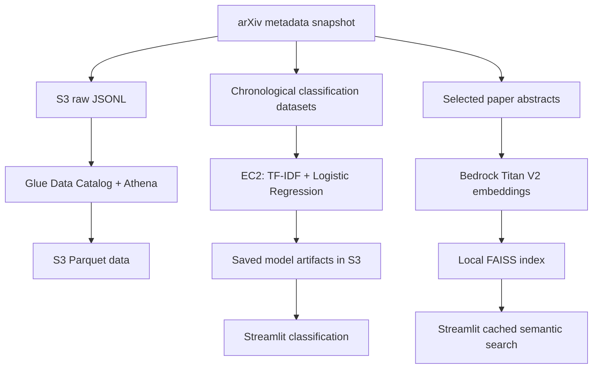

# AI Research Paper Explorer on AWS

I built this project for DS483 Cloud Computing at Embry-Riddle Aeronautical University. I wanted to explore how AWS data engineering, traditional machine learning, and semantic search could work together to help people discover research papers.

- **Developer:** Afonso Azevedo
- **AWS region:** `us-east-1`
- **Project:** AI Research Paper Discovery and Classification on AWS
- **Status:** Working local Streamlit application with completed classification and retrieval evaluations

## What I built

My application has two features:

1. **Classify an abstract:** I use a saved TF-IDF and Logistic Regression pipeline to predict one of eight computer science categories.
2. **Discover related papers:** I use Titan Text Embeddings V2 and FAISS to retrieve similar arXiv papers and display their metadata, similarity scores, and links.

The classification feature accepts new abstracts. My semantic search demonstration currently supports previously cached query embeddings only. This is intentional: submitting a query in the application does not generate a new paid Bedrock request.

I built and tested the application locally. I have not deployed it as a public service.

## Architecture



I used AWS for data storage, SQL analysis, model training, and embedding generation. FAISS and the current Streamlit application run locally. The Streamlit app does not query Athena or call Bedrock during cached retrieval.

### AWS services

| Service | How I used it |
|---|---|
| Amazon S3 | Store raw metadata, Parquet output, prepared datasets, and model artifacts |
| AWS Glue Data Catalog | Define the schemas Athena uses to access my S3 data |
| Amazon Athena | Query raw JSONL and Parquet tables using SQL |
| Amazon EC2 | Train and evaluate the TF-IDF and Logistic Regression classifier |
| Amazon Bedrock | Generate 512-dimensional Titan Text Embeddings V2 vectors |
| IAM | Control access to AWS resources and services |

## Data engineering

I started with the [Cornell University arXiv metadata snapshot](https://www.kaggle.com/datasets/Cornell-University/arxiv). My validated local snapshot contains **3,233,620 papers** and is approximately **5.28 GiB**.

I defined the raw JSONL table with Athena and the Glue Data Catalog, converted the records to SNAPPY-compressed Parquet, and ran validation and comparison queries. I kept the SQL steps in [`sql/`](sql/).

For one category-frequency benchmark, I measured:

| Measurement | Raw JSONL | Parquet |
|---|---:|---:|
| Bytes scanned | 5,667,856,783 | 9,417,392 |
| Total query execution | 2,295 ms | 950 ms |

The Parquet query scanned **99.83% fewer bytes** in this recorded comparison. Its total execution time was **58.61% lower** for this run. These measurements describe this specific Athena benchmark, not a guaranteed speedup for every query.

I preserved the query details in [`data_engineering/results/category_benchmark.json`](data_engineering/results/category_benchmark.json). The complete arXiv dataset is not stored in GitHub.

## Research paper classification

### Dataset and categories

I selected eight arXiv categories:

| Code | Category |
|---|---|
| `cs.AI` | Artificial Intelligence |
| `cs.CL` | Computation and Language |
| `cs.CR` | Cryptography and Security |
| `cs.CV` | Computer Vision |
| `cs.DB` | Databases |
| `cs.LG` | Machine Learning |
| `cs.NI` | Networking and Internet Architecture |
| `cs.RO` | Robotics |

I used the first listed category in the metadata as the classification label. I normalized whitespace, removed abstracts shorter than 30 words, and removed exact duplicate abstract groups before splitting the data. This does not detect paraphrased or near-duplicate abstracts.

I split papers by their original submission date to separate older training data from newer evaluation data:

| Split | Submission period | Papers |
|---|---|---:|
| Training | Before 2024 | 40,000 |
| Validation | 2024 | 77,187 |
| Held-out test | 2025 to 2026 | 207,257 |

For training, I sampled **5,000 papers per category** with random seed 42. I kept the naturally imbalanced distributions in validation and testing. The dataset preparation script is [`classification/prepare_dataset.py`](classification/prepare_dataset.py).

### Model

I trained a scikit-learn pipeline on EC2:

1. **TF-IDF** converts abstracts into numerical features using individual words and two-word combinations. I limited the vocabulary to 100,000 features.
2. **Logistic Regression** learns to assign one of the eight category labels from those features.

I fit the vectorizer and classifier using training data only. I evaluated the trained model separately and preserved model checksums and training metadata. The main implementation is in [`classification/train.py`](classification/train.py), with diagnostics in [`classification/diagnostics.py`](classification/diagnostics.py).

### Verified classification results

| Metric | 2024 validation | 2025 to 2026 held-out test |
|---|---:|---:|
| Papers evaluated | 77,187 | 207,257 |
| Accuracy | 80.59% | 74.93% |
| Macro-F1 | 75.64% | 72.63% |
| Balanced accuracy | 79.94% | 76.59% |

I froze the model before the final test and evaluated it once without retraining or tuning against the held-out results. The majority-class baseline on the test set was **26.88%**.

The evaluation files are:

- [`classification/results/model_freeze.json`](classification/results/model_freeze.json)
- [`classification/results/final_test_2025_2026.json`](classification/results/final_test_2025_2026.json)
- [`classification/evaluate.py`](classification/evaluate.py) for 2024 validation
- [`classification/evaluate_test.py`](classification/evaluate_test.py) for the protected final test

These results are specific to my eight-category dataset. Label selection, near duplicates, and changes in the research literature are limitations.

## Semantic paper discovery

I generated normalized 512-dimensional embeddings with **Amazon Titan Text Embeddings V2** and used a local **FAISS IndexFlatIP** index to find the closest paper vectors.

The working demonstration searches **368 arXiv papers**. This is a small research demonstration corpus, not an index of all 3.23 million papers.

The Streamlit app retrieves the top five papers for a supported cached query. It displays titles, abstract previews, research categories, cosine similarity scores, and links to arXiv. With normalized query and paper vectors, inner-product ranking is equivalent to cosine-similarity ranking.

The main retrieval modules are:

- [`semantic_search/query_embedding.py`](semantic_search/query_embedding.py): validate and cache query embeddings
- [`semantic_search/query_service.py`](semantic_search/query_service.py): reject uncached queries in offline mode
- [`semantic_search/retrieval.py`](semantic_search/retrieval.py): load the FAISS index and return paper metadata
- [`app/search_service.py`](app/search_service.py): connect retrieval to the Streamlit app

### TF-IDF versus Titan evaluation

I compared both retrieval methods using the same 368-paper corpus and ten existing-paper queries. I evaluated their rankings with **174 relevance judgments**.

| Metric | TF-IDF | Titan V2 |
|---|---:|---:|
| Mean Precision@5 | 0.54 | 0.62 |
| Mean nDCG@10 | 0.6315 | 0.6372 |

The relevance grades were AI-proposed and approved by one assessor. They were not independently verified by multiple human reviewers. My experiment is small and includes a targeted cybersecurity expansion, so I cannot claim that Titan is always better than TF-IDF.

I preserved the approved judgments, rankings, metrics, and evaluator in [`semantic_search/evaluation/`](semantic_search/evaluation/).

### Reconstructing the final FAISS index

The final index combines an existing 312-paper FAISS index with 56 additional cybersecurity-focused embeddings. I recorded the exact source file SHA-256 hashes in the local `faiss_368/provenance.json`.

The reconstruction script is [`semantic_search/scripts/rebuild_faiss_368.py`](semantic_search/scripts/rebuild_faiss_368.py). It needs these generated local files, which are intentionally excluded from GitHub:

- `semantic_search/data/faiss_312/index.faiss`
- `semantic_search/data/faiss_312/paper_ids.json`
- `semantic_search/data/embeddings_25k/cybersecurity_56_manifest.json`
- `semantic_search/data/embeddings_25k/cybersecurity_56_state.json`
- `semantic_search/data/faiss_368/provenance.json`

After restoring those files and the saved final index, run:

```bash
python semantic_search/scripts/rebuild_faiss_368.py
```

**Verified locally on November 13, 2026:** all four source hashes matched provenance; the reconstruction contained 368 unique papers, passed 368/368 self-retrieval, and matched the saved final index vectors. This read-only check wrote no files and made no AWS requests. The script also supports an explicit `--output-dir` for a separate copy, but that writing mode has not yet been independently verified.

## Run the application locally

### 1. Clone the repository

```bash
git clone https://github.com/AfonsoAzevedo/arxiv-research-explorer-aws.git
cd arxiv-research-explorer-aws
```

### 2. Install dependencies

I tested the application locally using Python **3.14.4**. Create a virtual environment and install the recorded application dependencies:

```bash
python3 -m venv .venv
source .venv/bin/activate
python -m pip install -r requirements-app.txt
```

A completely fresh installation on another machine has not yet been independently verified.

### 3. Restore the saved artifacts

I intentionally excluded datasets, model binaries, FAISS indexes, and cached embeddings from GitHub. Before launching the full application, restore these files to their expected locations:

```text
classification/models/full-40000-seed42/classifier.joblib
semantic_search/data/faiss_368/index.faiss
semantic_search/data/faiss_368/paper_ids.json
semantic_search/data/application_368.jsonl
semantic_search/data/application_query_cache/
```

The training script saves production artifacts under a run directory named `full_40000_seed42`, while the current application expects its separately restored classifier under `full-40000-seed42`. These paths are not interchangeable without placing the model in the correct application location.

I restored and tested the working artifacts locally, but they are not publicly distributed. A new GitHub clone cannot run the complete demonstration until the artifacts are restored. The verified FAISS reconstruction check also needs the original 312-paper index and the 56-paper expansion checkpoint, which are not publicly distributed.

### 4. Run Streamlit

```bash
python -m streamlit run app/main.py --server.address 127.0.0.1 --server.port 8501
```

Open `http://127.0.0.1:8501`.

For the cached semantic search demonstration, use this exact query:

```text
Deep learning methods for detecting cybersecurity threats and network intrusions
```

You can enter new abstracts for classification. An uncached semantic query produces a warning and does not invoke Bedrock.

## Tests and reproducibility

I tested classifier inference, empty-input handling, cached semantic search, uncached-query rejection, and empty search input.

```bash
python -m unittest discover -s tests -p 'test_app_services.py' -v
```

**Verified locally on November 13, 2026:** All five service tests passed. I also checked Streamlit startup, a classification example, five retrieved papers with working arXiv links, and the uncached-query warning.

The automated tests require the saved local artifacts. These are service-level tests, not a complete browser test suite.

I preserved my SQL workflow, classification preparation and evaluation scripts, model-freeze metadata, retrieval judgments, and metric files in GitHub. I did not commit the full dataset, model binaries, credentials, private keys, or cached embeddings.

**Important:** Some embedding scripts support authorized paid Bedrock requests. Do not execute those modes as part of ordinary local setup or testing.

## Project structure

```text
app/                  Streamlit interface and application services
classification/       Dataset preparation, model training, and evaluations
data_engineering/     Recorded Athena benchmark results
semantic_search/      Embedding, retrieval, and evaluation code
sql/                  Raw JSONL, Parquet, validation, and benchmark queries
tests/                Offline application service tests
requirements-app.txt Application dependencies
```

## Limitations and next steps

- My classifier predicts the first listed category rather than an independently verified single-topic label.
- My dataset checks remove exact duplicate abstracts, not near duplicates.
- The FAISS demonstration covers only 368 papers and cached query embeddings.
- My retrieval evaluation uses ten queries and relevance judgments from a single assessor.
- The repository does not publicly distribute the required local model and search artifacts.
- Reconstructing the final 368-paper index was verified locally, but requires the preserved original baseline and expansion artifacts. Those inputs are not included in a public clone.
- The application has not been publicly deployed, and I have not reported comprehensive application latency or total AWS charges.

I built the project individually for DS483 Cloud Computing. My goal was to connect real AWS data and machine learning workflows to a working application while keeping the experimental results and limitations transparent.
